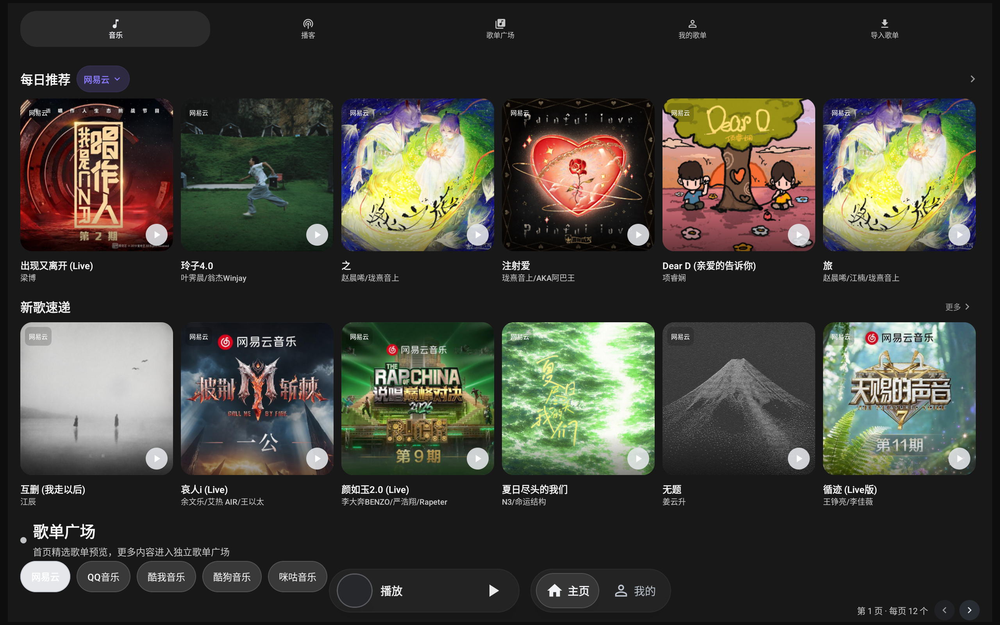
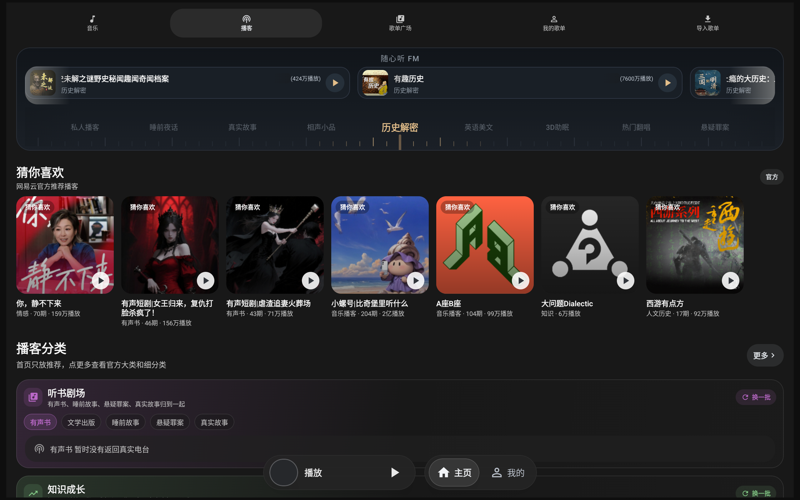
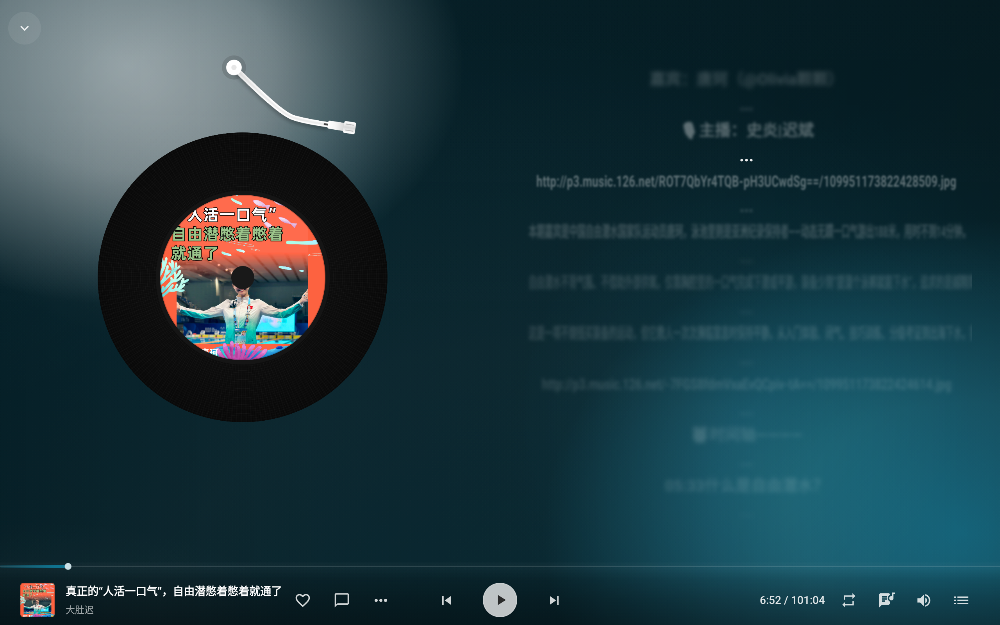

# 树夏music

面向车机、平板和横向大屏的 Android 音乐播放器，支持落雪插件。

## 产品截图

### 软件界面截图

软件界面截图。

软件界面截图。

### 软件界面截图

软件界面截图。

## 运行要求

### 最低运行配置

| 项目 | 要求 |
| --- | --- |
| Android 系统 | Android 8.0 / API 26 及以上 |
| 处理器 | `armeabi-v7a` 或 `arm64-v8a` 的 Android 车机 / 平板 |
| 内存 | 2 GB RAM 及以上 |
| 屏幕 | 建议 1280 × 720 及以上的横向屏幕 |
| 网络 | 需要可用网络 |
| 可用存储 | 至少预留 1 GB；下载歌曲时需额外预留媒体文件空间 |

### 推荐体验配置

| 项目 | 建议 |
| --- | --- |
| Android 系统 | Android 10 / API 29 及以上 |
| 处理器 | 64 位 `arm64-v8a` |
| 内存 | 4 GB RAM 及以上 |
| 屏幕 | 1280 × 720、1920 × 720 或更高分辨率横向屏幕 |
| 使用场景 | 车机、Android 平板、横向大屏设备 |

> Android 8.0 是项目的实际最低系统版本；其余项目为对外推荐配置。

## 最新版本

当前截图对应版本：`2.5.19 (44)`。

下载与更新请前往 GitHub Release：<https://github.com/maiga512/shuxiamusic-release/releases/latest>
